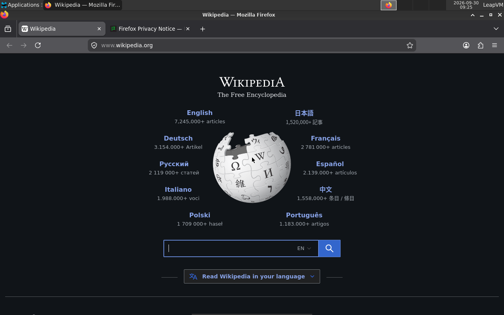

# LeapVM
A from-scratch Linux virtual machine for Apple Silicon Macs, built directly on Hypervisor.framework, with near-native performance.

從零打造的 Apple Silicon 虛擬機，讓 Linux 在 Mac 上跑，而且損失盡量小。



不使用 QEMU、UTM，也不使用 Apple 的 Virtualization.framework。程式直接呼叫 macOS 最底層的 Hypervisor.framework，虛擬硬體全部自己寫，共約 2,800 行 C 與 Objective-C。

## 能做什麼

雙擊 `啟動.command`，會跳出一個視窗，裡面是一台完整的 Linux 電腦（Alpine Linux 3.24 + XFCE 桌面）：

- 有桌面、視窗、滑鼠，文字直接顯示在視窗裡
- 可以上網（內建 Firefox），可以用 `apk` 安裝軟體
- 檔案存在虛擬硬碟裡，關機再開機都還在
- 關掉視窗時會先讓 Linux 正常關機，不會弄壞檔案

登入資訊：使用者 `leap`，密碼 `leap`（開機會自動登入）。要用管理員權限時，在指令前面加 `doas`，例如 `doas apk add htop`。

## 效能損失

測試環境：MacBook Pro（M5、16GB、macOS 27.0）。

### 計算與記憶體

同一支測速程式（`bench/`），在 Mac 上直接跑、在 LeapVM 的 Linux 裡跑：

| 項目 | Mac 直接跑 | LeapVM 裡 | 損失 |
|---|---|---|---|
| 純運算 | 0.532 s | 0.536 s | +0.8% |
| 連續讀寫 256MB 記憶體 | 0.119 s | 0.121 s | +1.3% |
| 隨機讀寫 256MB 記憶體 | 0.122 s | 0.125 s | +2.5% |

### 硬碟與網路

| 項目 | Mac 直接 | LeapVM 裡 | 比例 |
|---|---|---|---|
| 硬碟寫入 1GB | 8,234 MB/s | 4,876 MB/s | 59% |
| 硬碟讀取 1GB | 23,698 MB/s | 8,533 MB/s | 36% |
| 從 Mac 本機下載 | 5,296 MB/s | 約 1,200–2,100 MB/s | 約 25–40% |
| 從網際網路下載 | 1 MB/s | 1 MB/s | 相同 |

說明：Mac 那邊的硬碟數字來自記憶體快取，所以特別高。LeapVM 裡的速度已經超過一般 SSD 本身的速度，也遠高於家用網路，實際使用時感覺不到差別。

### 閒置時對 Mac 的負擔

| 情況 | LeapVM 佔用 |
|---|---|
| 桌面閒置、沒開視窗 | 一顆 CPU 核心的 0.3% |
| 桌面閒置、開著視窗 | 一顆 CPU 核心的 1.1% |

### 其他

| 項目 | 結果 |
|---|---|
| 開機到出現登入畫面 | 約 3 秒 |
| 開機到桌面可以操作 | 約 10 秒 |
| 按電源鍵到關機完成 | 約 3 秒 |

## 為什麼損失小

1. **不轉譯**：Mac 和這個 Linux 都用 ARM 指令，Linux 的程式直接在真的 CPU 上跑，只有碰到硬體時才需要 LeapVM 介入。
2. **virtio 虛擬硬體**：硬碟、網路卡、鍵盤滑鼠都用 virtio 這套專門給虛擬機設計的標準。Linux 把一整批工作放進共用的佇列，只「敲一次門鈴」，大幅減少被打斷的次數。
3. **不多複製資料**：硬碟讀寫直接在「Linux 指定的那塊記憶體」和硬碟檔之間搬移，中間不另外複製一份。
4. **批次通知**：網路一次收一大批封包，才通知 Linux 一次。
5. **閒置時省電**：畫面半秒沒變化，就從每秒檢查 60 次降到 10 次；一有操作馬上恢復。

## 虛擬硬體

| 裝置 | 做法 | 檔案 |
|---|---|---|
| CPU | Hypervisor.framework，最多 8 顆 | `src/vcpu.c` |
| 中斷控制器 | macOS 內建的 GICv3 | `src/main.c` |
| 序列埠 | 模擬 PL011 | `src/uart.c` |
| 時鐘 | 模擬 PL031 | `src/rtc.c` |
| 硬碟 | virtio-blk，內容存在 `guest/disk.img` | `src/virtio_blk.c` |
| 網路卡 | virtio-net，透過 libslirp 連到 Mac 的網路 | `src/virtio_net.c` |
| 鍵盤、滑鼠 | virtio-input | `src/virtio_input.c` |
| 螢幕 | 記憶體裡的一塊，Linux 用 simpledrm 驅動 | `src/display.m` |
| 硬體清單 | 產生 Device Tree 給 Linux | `src/fdt.c` |

網路的特別處理：Linux 查網址（DNS）時，由 LeapVM 用 Mac 自己的 DNS 設定去查。這樣不管家裡、學校或展場的網路，只要 Mac 能上網，Linux 就能上網。

## 怎麼安裝與執行

需要：Apple 晶片的 Mac、macOS 15 以上、Xcode Command Line Tools、Homebrew 的 `libslirp`（`brew install libslirp`）。

```sh
make run                          # 編譯，並用測試用的迷你 Linux 開機（只有命令列；第一次會下載約 20MB）
```

完整的桌面系統：

```sh
python3 tools/install_alpine.py   # 把 Alpine Linux 裝進虛擬硬碟（約 2 分鐘）
python3 tools/setup_desktop.py    # 安裝 XFCE 桌面、Firefox、中文字型（下載約 1GB，約 3 分鐘）
./啟動.command                     # 開機（或在 Finder 裡雙擊）
```

`啟動.command` 第一次執行時，會自動做前兩個步驟。Linux 本身不在這個 repo 裡：核心和安裝檔會從 Alpine 官方站下載，虛擬硬碟在你的電腦上產生。

執行中的操作：

| 操作 | 作用 |
|---|---|
| 關閉視窗、⌘Q | 按下虛擬電源鍵，Linux 正常關機後結束 |
| 再按一次 ⌘Q | 強制結束（Linux 卡住時才用） |
| 關掉終端機視窗、`kill` | 同樣先按電源鍵等 Linux 關機；30 秒沒關才強制結束 |
| 終端機裡按 Ctrl-A 再按 x | 強制結束 |

## 測試

```sh
./tests/run_all.sh                # 開機、畫面、桌面操作、結束訊號、裝置反覆重設
python3 tests/bench_overhead.py   # 計算與記憶體的效能損失
python3 tests/bench_io.py         # 硬碟與網路的效能
```

### 穩定度（`stress/`）

| 測試 | 內容 | 結果 |
|---|---|---|
| `reboot.py` | 開機→登入→關機，連續 15 次 | 全部成功，開機 4.8～6.1 秒，主機記憶體沒有累積 |
| `crash.py` | 寫檔到一半直接 `kill -9`（模擬拔電源），重開機 | 之前存好的 50 個檔案全部完整，檔案系統自動修復，沒有錯誤 |
| `dns.py` | 200 個網址查詢同時發出 | 200 個全部成功，沒有丟封包，記憶體沒有洩漏 |
| `soak.py` | CPU、硬碟、網路、DNS、滑鼠鍵盤、畫面同時操 10 分鐘 | Linux 核心零錯誤、回應一直是 0.1 秒；硬碟寫入 50 GB、網路收 392 GB、零丟包；約 6,000 次 DNS 查詢只有 1 次失敗（上游伺服器逾時）；主機記憶體沒有累積 |

這些測試找到並修掉的問題：

- DNS 轉送原本每個查詢開一個 socket、上限 64 個，200 個同時查只成功 55 個 → 改成兩個 socket 加交易編號對應，上限 1024
- 網路佇列 256 格在小封包大量湧入時來不及接 → 加大到 1024 格
- 家用路由器的 DNS 在大量查詢時約 1.5% 沒有回應 → 逾時 2 秒自動換下一台伺服器，並記住上次有回應的那台優先問；`stats` 指令會顯示逾時次數
- Mac 睡眠時虛擬機的時鐘會停住（Apple 的計時器不含睡眠時間），醒來後 Linux 的時間會慢 → LeapVM 每秒比對「含睡眠」與「不含睡眠」兩種時鐘，發現睡過就把虛擬機的時鐘一次撥到正確時間（`tests/test_clock.py` 用模擬的方式驗證）

## 原始碼導覽

| 位置 | 內容 |
|---|---|
| `src/` | 虛擬機本體 |
| `tools/` | 安裝 Linux、安裝桌面的工具 |
| `tests/` | 自動化測試與效能測試 |
| `bench/` | 效能測試程式（同一份程式碼編成 macOS 版和 Linux 版） |
| `guest/` | Linux 核心、測試用的迷你系統、虛擬硬碟 |

## 已知限制

- 硬碟的「flush」用的是 macOS 的 `F_BARRIERFSYNC`（保證寫入順序，但不等 SSD 真的寫完）。Linux 正常關機時資料一定完整；只有 **Mac 本身突然斷電**時，最後幾秒的寫入可能遺失。這是為了效能刻意的取捨
- 控制通道（`--ctl`）是本機 Unix socket，同一台 Mac 上的其他使用者也連得上；只在自己的電腦上用
- 沒有聲音
- 沒有 3D 顯示卡：桌面用 CPU 畫，一般操作沒問題，但不適合玩 3D 遊戲
- 螢幕固定 1280×800
- 目前對虛擬機隱藏了 SME（矩陣運算擴充指令）
- Linux 核心要跟硬碟裡的驅動程式版本一致。在 Linux 裡升級核心（`apk upgrade` 更新到 `linux-virt`）之後，要重新把 `/boot` 裡的核心和 initramfs 複製到 `guest/installed/`

## 相關作品

| 作品 | 說明 |
|---|---|
| QEMU、UTM | 功能完整的虛擬機，程式碼大得多 |
| Apple Virtualization.framework | Apple 官方的高階虛擬機框架 |
| ingot | 另一個從零寫在 Hypervisor.framework 上的虛擬機 |

LeapVM 的定位：用精簡、看得懂的程式碼，做出一台能日常使用的 Linux 虛擬機，而且每一項效能損失都有實測數字。

## 授權

Linux 核心、Alpine Linux、BusyBox 屬於各自的作者，依各自的授權發行。
